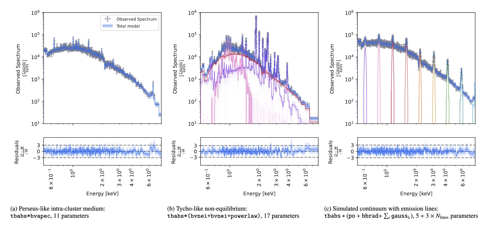

# XraySpectroBenchmark

This is the companion repository of the paper "Benchmarking advanced X-ray spectral fitting methods in the NewAthena era".
We aim for a broader scope to serve as a benchmarking platform for spectral of complex datasets against a variety of inference algorithms.

We currently host the spectral test data, models, and code discussed in the paper. 
The code notebooks can also serve as tutorials to explore new inference algorithms.

In this study, we benchmark inference techniques currently available in X-ray spectroscopy, i.e. maximum-likelihood minimisation with Levenberg-Marquardt (LM), nested sampling (NS), gradient-based samplers, variational inference and simulation-based inference (SBI). These methods are tested on mock X-IFU observations of a galaxy cluster and a supernova remnant, and an empirical model with an arbitrary number of emission lines to test the dimension scaling.

